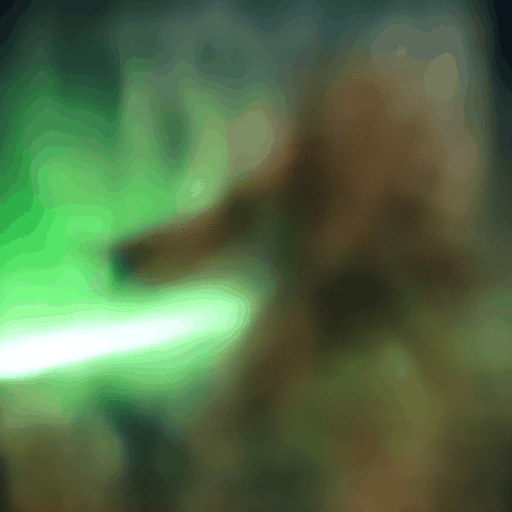
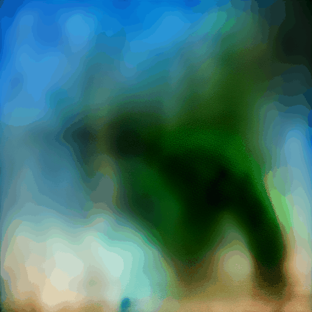
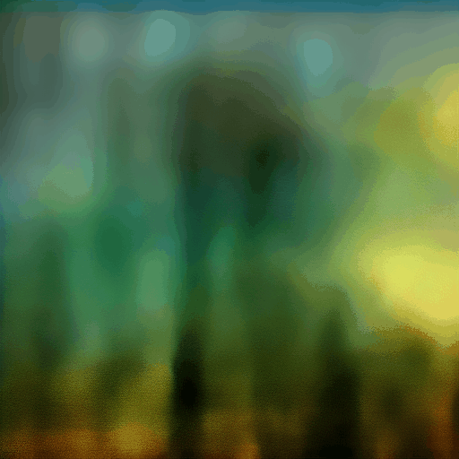
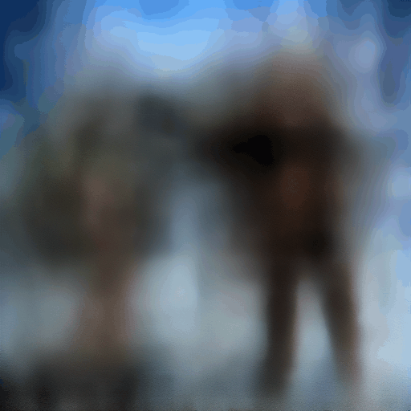
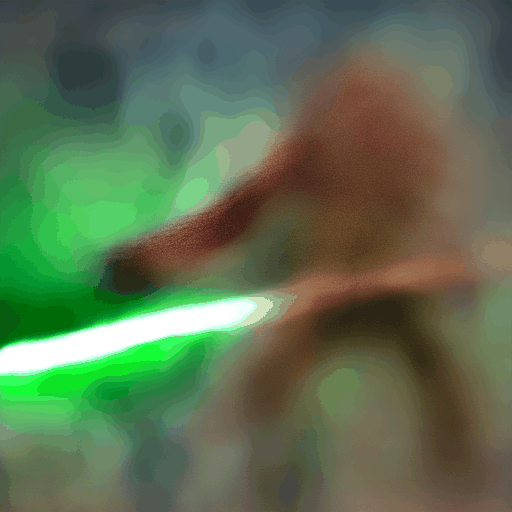
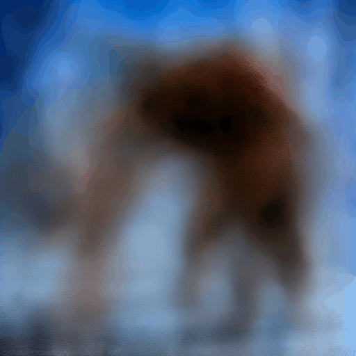
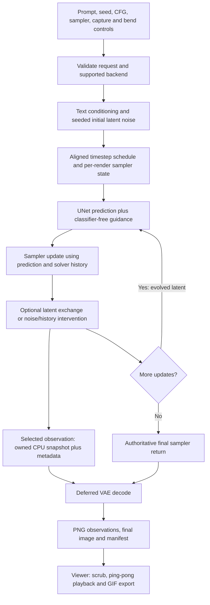

# Sampler circuit bending: progress, gallery and pipeline guide

Recorded 10 October 2026. FlexDiffusion now exposes the denoising process as an
art material: capture its intermediate images, alter its noise or memory, and
let PLMS and DDIM take turns or exchange evolving latent states. Finite glitches
are intentional outputs, including stretching, ghosting, unstable outlines and
colour saturation. The controls remain opt-in.

## Selected animations

These are six curated sequences from the existing Titan RTX renders, not new
renders. Each is **512 × 512, SD1.4, CFG 10, 16 exact updates**, with all 16
observations included. The first 15 images are decoded clean estimates; the
last is the returned final image. Each GIF has a matching JSON sidecar containing
the complete generation request, bend options, observation metadata, source RGB
hashes and export settings.

Playback is the viewer's speed setting **8**, continuous enabled: steps
`1 → 16 → 2 → repeat`, with one-second holds at steps 1 and 16. GIF timing rounds
to 10 ms, giving 130 ms per moving frame and **5.64 seconds per cycle**. The
reverse half replays saved images; it does not reverse diffusion. Separately,
the sampler's oscillation setting changes exchange during the forward render.

### Oscillating PLMS/DDIM exchange — seed 3



My lead example: early colour and shape swings settle into a metallic reptile
head, with conspicuous changes around the jaw, teeth and crest. Both samplers
start with seed 3. Exchange rises and falls from 0 to 0.5 over an eight-update
cosine cycle; the exported branch is PLMS and history uses shared predictions.
DDIM eta is zero, so this isolates sampler interaction from stochastic noise.

[Recipe and provenance](gallery/2026-10-10/plms-coupled-oscillate-seed3.json) ·
[All steps](gallery/2026-10-10/plms-coupled-oscillate-seed3-steps.jpg)

### The same oscillation — seed 5



The same settings with another initial noise field produce a different body and
silhouette progression. This pair is useful for judging the technique across
seeds rather than treating one attractive result as a general rule.

[Recipe and provenance](gallery/2026-10-10/plms-coupled-oscillate-seed5.json) ·
[All steps](gallery/2026-10-10/plms-coupled-oscillate-seed5-steps.jpg)

### Alternating PLMS/DDIM updates, shared history — seed 4



PLMS performs update 1, DDIM update 2, PLMS update 3, and so on, on one live
latent. Every prediction enters PLMS's history. The stretched, torn-looking
structure is one of the stronger circuit-bending effects in this batch.

[Recipe and provenance](gallery/2026-10-10/plms-alternate-shared-seed4.json) ·
[All steps](gallery/2026-10-10/plms-alternate-shared-seed4-steps.jpg)

### Alternating updates, deliberately stale history — seed 2



PLMS keeps only its own previous predictions while DDIM advances the latent in
between. The resulting mismatch produces alternating sharpness, ghosting and
outline changes. Shared history was more structurally disruptive in some other
seeds; stale does not necessarily mean a stronger glitch.

[Recipe and provenance](gallery/2026-10-10/plms-alternate-stale-seed2.json) ·
[All steps](gallery/2026-10-10/plms-alternate-stale-seed2-steps.jpg)

### Earlier side experiment: independent two-seed oscillation



This uses **PLMS for both branches**, seeds 3 and 5. An eight-update cosine
crossfade blends the exported latent estimates, with no feedback into either
trajectory. It remains a useful visual option, but is distinct from the
sampler-type interlacing requested later. Its extremes return to the corresponding
independent branch instead of inheriting earlier exchanges.

[Recipe and provenance](gallery/2026-10-10/plms-independent-oscillate-seed3.json) ·
[All steps](gallery/2026-10-10/plms-independent-oscillate-seed3-steps.jpg)

### Earlier side experiment: held DDIM noise



Generation seed 2, separate noise seed 123, eta 0.8 and noise memory 1. The same
noise field is reused at active stochastic updates, producing saturated,
static-like imagery. This deliberately nonstandard correlation stays available
as an experimental texture source.

[Recipe and provenance](gallery/2026-10-10/ddim-held-seed2.json) ·
[All steps](gallery/2026-10-10/ddim-held-seed2-steps.jpg)

The [final-output overview](gallery/2026-10-10/sampler-final-overview.jpg) compares
all seven sampler recipes across seeds 2–5. The prompt asks for a humanoid
dinosaur cyborg carrying a futuristic kinetic anti-materiel rifle. SD1.4 does
not reliably follow that anatomy: some seeds produce separate human and dinosaur
figures or oversized heads. These selections demonstrate the trajectory effects,
not a claim that character prompting is solved.

## Progress recorded in this pass

| Area | Implemented and observed |
| --- | --- |
| Intermediate output | DDIM, PLMS and five UniPC presets added beside nine fixed-step k-diffusion samplers; sparse or all-step capture, clean estimates and raw state labels |
| Euler/Heun noise | Churn, noise amplitude, separate noise seed, fresh/correlated/held noise, iteration or percentage windows, pulses and fades |
| PLMS history | Owned frozen-history snapshots and a blend strength; native live history continues to advance |
| DDIM | Eta, private noise RNG, noise memory/amplitude and optional exact-count timetables |
| Seed experiments | Borrow another PLMS seed's history; feed latent blends back; or export blends of independent trajectories; constant, progressive, cosine and hard-block movement |
| Sampler experiments | PLMS/DDIM alternation on one latent, or two coupled trajectories; shared, stale or reset PLMS history; constant, progressive or oscillating exchange |
| Comparison workflow | Two-axis bend grids, per-seed ordinary references, recipe import/export, settings restore and review metadata |
| Viewer | Step scrubbing, play/pause, speed slider, one-second endpoint holds, continuous ping-pong and GIF export using current playback settings |
| Character studies | All 20 steps for the first PLMS comparison; 16-step character grids; ordinary PLMS portrait sweep at 512 × 1024, seeds 1–8, CFG 1–16 |

The character CFG/seed sweeps were explicitly requested exceptions to the normal
512-square, seeds 2–5 sample policy. Later sampler experiments returned to those
defaults. Full local render batches remain in the evidence directory; Git keeps
this curated gallery and its metadata rather than thousands of PNGs or models.

## What happens in the data pipeline



### 1. The seed initializes a latent; the prompt conditions predictions

For these SD1.4 samples, a 512-square image is represented during sampling by a
four-channel 64-square latent tensor. The generation seed creates the initial
noise. Text conditioning and CFG guide UNet predictions at successive noise
levels. Each solver uses those predictions to calculate its next latent.

All sampler-interlace examples use the same prompt, conditioning, initial noise
and alpha/timestep schedule for both solvers. There is no donor seed in that
experiment. Noise seed 123 remains in the recipe but is unused at eta zero.

### 2. Timetable alignment is part of the experiment

The installed native DDIM/PLMS schedule can produce a different number of updates
from the requested count: a request for 30 gives 31. Some counts include an
invalid index and are rejected. The opt-in exact schedule uses evenly spaced,
unique, bounded training timesteps; 16 now means 16 actual updates. It changes
the discretization, so both neutral and bent comparisons must use the same
schedule. The grid's reference cells preserve that choice.

### 3. PLMS carries memory; DDIM lets us hand off one step at a time

PLMS combines the current epsilon prediction with up to three previous
predictions. Altering those predictions can change the solver's direction even
when the visible image initially looks similar. Freeze and donor-history modes
intervene in this memory. DDIM's next update uses the current latent and current
prediction, with optional stochastic noise controlled by eta.

In **alternate** mode one evolving latent changes hands:

```text
initial x → PLMS update 1 → DDIM update 2 → PLMS update 3 → DDIM update 4 → …
```

Block length chooses how many consecutive updates each sampler gets. The first
sampler runs outside the active switching window/pulses. Fades can scale DDIM
noise, but do not make the sampler selection fractional.

| PLMS history policy | What it means during alternation |
| --- | --- |
| Shared | Append predictions from both sampler types at each update |
| Stale | Append only PLMS predictions; gaps intentionally violate the usual history spacing |
| Reset | Clear history on each switch; PLMS performs warm-up again when it returns |

An instance-local model proxy observes DDIM's existing prediction and applies
the same CFG combination. Sharing its prediction requires no additional UNet
evaluation. Resetting history does add PLMS warm-up work.

### 4. Coupled trajectories exchange latent tensors before the next step

Both samplers advance their own latent at the same timestep, then exchange
simultaneously. If `P` and `D` are their newly updated states:

```text
P_next = (1 − q) × P + q × D
D_next = (1 − q) × D + q × P
```

At `q=0` the branches remain independent; at `q=0.5` they join exactly; at `q=1`
they swap. Both equations use the same pre-exchange pair. Those new tensors
feed the next update, so even returning q to zero does not undo prior exchanges.

The gallery's oscillation uses
`q = 0.5 × (1 − cos(2π × (iteration − first) / 8)) / 2`.
Window, pulse and fade weights multiply it. Progressive mode ramps from zero
to the selected exchange amount across the window; constant mode holds that
amount. Export can show PLMS, DDIM or an equal latent blend.

Shared history blends the current predictions by q before appending to PLMS
memory. Stale history retains PLMS's prediction despite the changed latent.
Reset clears history after nonzero exchange. Each is a different experimental
interpretation of what memory should mean after intervention.

These are logically parallel trajectories executed sequentially on one GPU,
sharing a model. Coupling requires roughly twice the sampling work, with extra
warm-up cost under reset. It is not a second GPU job or a blend of decoded PNGs.

### 5. Noise memory changes temporal correlation

Euler/Heun churn adds noise at selected steps. DDIM eta changes stochastic
variance; noise amplitude scales the injected field. A private RNG separates
the noise seed from the initial generation seed. Memory evolves as:

```text
noise_next = memory × noise_previous + sqrt(1 − memory²) × fresh_noise
```

Zero memory gives fresh fields and one holds a field. It advances only when an
active update adds noise. Churn zero is Euler/Heun's neutral setting; eta zero
is deterministic DDIM. Noise amplitude zero alone is not a neutral setting,
because churn/eta still change other parts of the update.

### 6. Capturing, decoding and playing are separate operations

The sampler emits selected observations; the collector owns detached CPU
copies. VAE decoding of intermediate observations happens after sampling. The
normal final return remains authoritative. Sampler dispatch selects a per-render
adapter through a ContextVar; solver instances, histories and RNGs belong to that
render. DDIM overrides bind functions locally to the sampler instance.

The distinction between a **clean estimate** and a **solver state** matters:
the estimate predicts a clean image, while the solver state still contains the
current noise. Mixed samples capture after update N, with the clean estimate
computed by that update. Ordinary DDIM/PLMS reference estimates retain the
legacy input-boundary phase. UniPC captures its predictor estimate and corrected
state. Read `observation_phase` and `estimate_basis`; intermediate images from
different modes are not automatically phase-identical. Final comparisons are
directly meaningful when the rest of the request matches.

GIFs use the viewer's 256-colour per-frame indexed data. The publication exporter
uses Pillow's smaller LZW compression and the **same JavaScript timeline** as the
player. It checks source PNG hashes and independently decodes every timed GIF
frame to verify palette pixels, order, duration, dimensions and looping. GIFs
are presentation copies; the original PNGs retain full colour.

## Use the controls

1. Restart the backend and refresh the UI after installing this branch.
2. Use classic txt2img with an SD1.x epsilon-prediction model. Set 512 × 512,
   seed 2, CFG 10, 16 steps and capture `1-16`.
3. Choose PLMS or DDIM, enable Circuit bend, open Bend controls, and enable
   **Interlace sampler types: PLMS ↔ DDIM**. It starts with Exact steps and eta 0.
4. For the lead effect choose coupled trajectories, PLMS output, shared history,
   exchange 0.5, oscillate, period 8. Then repeat seeds 3, 4 and 5.
5. For discrete tearing choose alternate, first PLMS, block 1; compare shared,
   stale and reset. Keep a neutral PLMS and neutral DDIM reference on the same
   exact schedule. Save the recipe before refreshing a comparison grid.

The [full control guide](SAMPLER_OUTPUT_AND_BENDS.md) describes ranges and edge
cases. Import [the sampler grid](../../benchmarks/plms-ddim-sampler-grid.json)
using the bend grid's **Load recipe** button. Gallery sidecars are provenance
records rather than grid-import documents; use their `render.request` and
`render.circuit_bend` fields for exact individual settings.

## Reproduce and export

Rendering requires the classic runtime and a local SD1.4 checkpoint. Historical
validation used sdkit 2.1.1, stable-diffusion-sdkit 2.1.5 and k-diffusion 0.0.12.
Follow the root [AGENTS.md](../../AGENTS.md) policy; inspect active chats and Titan
processes/utilization before creating a fresh ownership record as described in
[`sample_render_policy.py`](../../scripts/sample_render_policy.py). The current
guard targets the project's Titan UUID; adapt that explicit identity if moving
to another machine. Another chat's cooling pause still reserves its GPU.

```powershell
python scripts/render_seed_bends.py --experiment sampler --model <checkpoint> --output <new-evidence-directory> --thread-check <fresh-check.json>
python scripts/build_step_viewer.py <evidence-directory>
python scripts/export_step_gif.py <evidence-directory> plms-coupled-oscillate-seed3 example.gif --fps 8 --continuous
```

The first command renders seven variants for each of seeds 2–5 and repeats all
seven seed-2 recipes. Use `--experiment seed` for the earlier two-seed/DDIM suite.
`--resume` verifies retained recipes and PNG hashes after a GPU guard pause.
Viewer construction and GIF export need Pillow; CLI export also needs Node.
They run on CPU and can reuse existing evidence without loading a model.

The [publication record](gallery/2026-10-10/publication.json) includes the checkpoint
SHA-256, runtime versions, batch counts and local checks. Full recipe/observation
records are preserved for [sampler interlacing](gallery/2026-10-10/sampler-interlace-20261010-results.json)
and [seed mixing/DDIM](gallery/2026-10-10/seed-bends-ddim-20261010-results.json),
including the sequences not selected for GIFs.

## Validation and boundaries

- The historical native-adapter comparison preserved final RGB pixels for
  DDIM, PLMS, five UniPC presets, Euler and Heun; requested-30 DDIM/PLMS runs
  correctly reported 31 native updates. This initial check used 256-square
  images; later artistic checks use the agreed 512-square policy.
- Sampler interlacing: **28 sequences, 448 frames**, including eight ordinary
  references and 20 mixed sequences. All seven seed-2 recipes repeated exactly
  across every exported frame. Dimensions, hashes and sampler labels were
  independently checked. [Audit](gallery/2026-10-10/sampler-interlace-20261010-verification.json).
- Seed mixing/DDIM: **36 sequences, 576 frames**; all nine seed-2 recipes repeated
  exactly. Independent seed mixing matched 76 A/B reference endpoints.
  [Audit](gallery/2026-10-10/seed-bends-ddim-20261010-verification.json).
- Native CPU tests cover final-tensor equivalence, model-call counts, schedule
  alignment, manual alternating updates, exchange endpoints, history policies,
  separate RNGs, request isolation and finite-state recovery. UI/player checks
  cover validation, restore, labels, timing and GIF behavior. Historical combined
  workspace test counts include unrelated manifest retry tests; publication
  validation is recorded in the pull request. This isolated branch passed **68
  Python tests**, JavaScript UI/player tests and the optional linkedom form tests.

Numerically finite glitches stay available. Non-finite sampling stops with a
warning and the last finite state; interrupted output is labelled partial. The
latest art batch completed without such stops. Exact repeatability here is a
result for the recorded runtime and hardware, not a promise across environments.

Sampler mixing currently supports this PLMS/DDIM pair in classic epsilon-model
txt2img. Other pairs, img2img and other backends are not implemented. UniPC SNR 2
has a native batching defect and is limited to one image per batch. Adaptive
samplers still need suitable intermediate-boundary adapters. The new controls
have CPU/native and render-runner evidence; a complete application HTTP and
multi-GPU matrix was not repeated for this pass.

Saved latents are observations, **not exact-resume checkpoints**. Exact resume
still needs persisted schedule position, RNG state, solver history and numerical
proof. The current image viewer does not edit or resume a latent trajectory.

## Most promising next experiments

1. Make exchange envelopes editable: independently control phase, depth and
   per-branch amounts, with neutral references and per-step q visible in the viewer.
2. Add spatial exchange masks: restrict PLMS/DDIM exchange to regions or frequency
   bands, keeping a global mode as the reproducible baseline.
3. Explore temporal memory controls: history decay, delay and weighted taps, with
   deliberate stale modes alongside mathematically conservative reset choices.
4. Capture both coupled outputs together so their convergence and divergence are
   visible without rerendering; include difference views and side-by-side playback.
5. Extend sampler pairs only after aligning their state/noise conventions. UniPC
   correction gain and Euler/Heun sharing need family-specific handling.

These are future directions, not implemented controls. The strongest immediate
focus is shaping oscillating exchange while preserving recipes and per-step
provenance, so a surprising glitch becomes something an artist can revisit.
